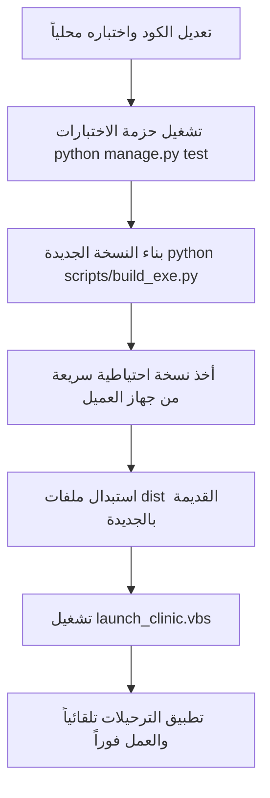
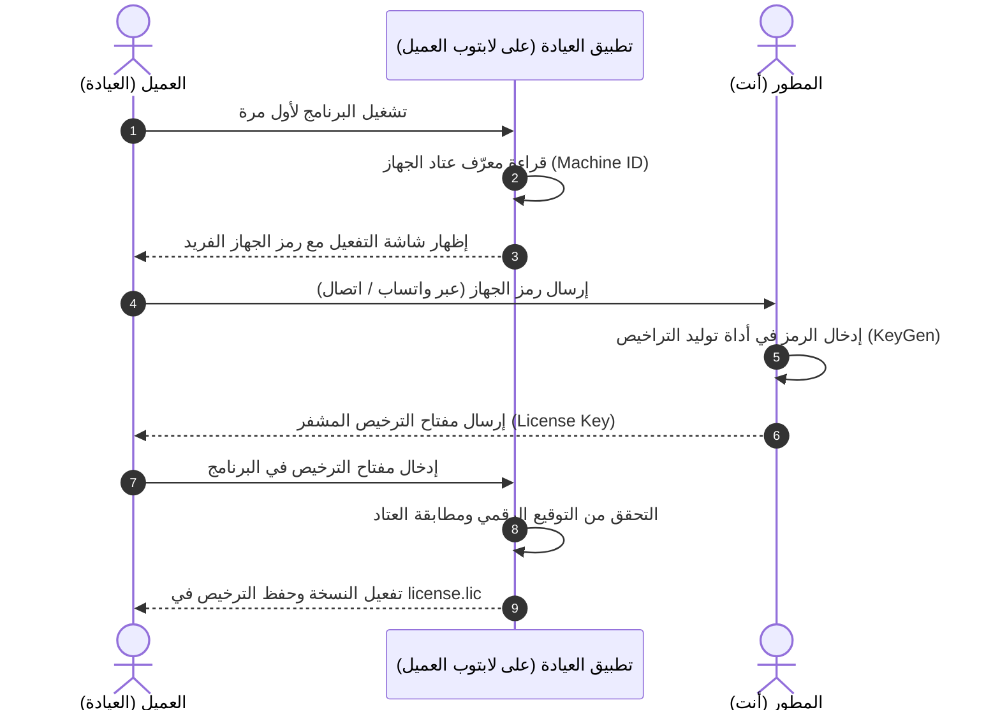

# Pawfect Clinic — الدليل الشامل للمطور (Developer & Setup Guide)

> **الإصدار:** 1.0.0 (Production-Ready)  
> **نوع النظام:** نظام إدارة عيادة بيطرية محلي بالكامل (Offline-First LAN System)  
> **البيئة المستهدفة:** Windows (Server + Client PCs over LAN)  
> **تاريخ الاعتماد والتحديث:** سبتمبر 2026  

---

## 1. المعمارية العامة ومبادئ التصميم (Architecture & Core Principles)

نظام **Pawfect Clinic** مبني على أسس معمارية صارمة تلبي متطلبات العيادات الطبية والبيطرية التي تتطلب خصوصية عالية واستقراراً تاماً دون اتصال بالإنترنت:

1. **العمل دون اتصال (Offline-First):**
   * النظام يعمل بنسبة 100% دون الحاجة إلى إنترنت.
   * لا يعتمد على أي خدمات سحابية خارجية، APIs خارجية، أو مكتبات CDN على الإطلاق.
   * كافة الخطوط والأيقونات والمكتبات (FullCalendar, Alpine.js, Tailwind CSS) مضمنة محلياً (`Self-Hosted`).

2. **شبكة العيادة المحلية (LAN-Ready):**
   * السيرفر يعمل على اللابتوب/الجهاز الأساسي ويستقبل اتصالات الأجهزة الأخرى المتصلة بنفس الراوتر (أجهزة الاستقبال، غرف الفحص، أجهزة الأطباء).
   * يدعم الوصول عبر IP أو اسم الجهاز أو الاسم الرمزي `http://pawfect:8000`.

3. **الفصل التام بين الكود والبيانات (Code vs Data Separation):**
   * كود التطبيق المترجم (Python + Django + خادم Waitress) مجمع داخل ملف تنفيذي `PawfectClinic.exe`.
   * البيانات المنظمة (المرضى، المواعيد، الزيارات، السجلات) مخزنة في **PostgreSQL**.
   * الملفات الطبية المرفوعة (الأشعة والتحاليل) مخزنة في مجلد **`media/`**.
   * هذا الفصل يتيح تحديث أو استبدال ملفات البرنامج مستقبلاً دون المساس بسجل مريض واحد.

4. **تأمين البيانات والحذف القابل للاسترجاع (Soft Deletion & Auditability):**
   * حذف السجلات يعتمد تقنية **Soft Delete** لمنع فقدان البيانات العرضي.
   * الحذف والاستعادة عمليتان منفصلتان تماماً في الصلاحيات.
   * جميع العمليات الحساسة توثق في سجل تدقيق غير قابل للتلاعب (`AuditLog`).

---

## 2. مكدس التقنيات (Tech Stack)

| المكون | التقنية المستخدمة | الدور في النظام |
|---|---|---|
| **لغة البرمجة** | Python 3.11+ | المحرك البرمجي الأساسي |
| **إطار العمل الخلفي** | Django 5.x | بنية MVC، إدارة الصلاحيات، والـ ORM |
| **خادم الإنتاج المدمج** | Waitress (WSGI Server) | خادم ويب احترافي متعدد الخيوط (Multi-Threaded) لنظام Windows |
| **قاعدة البيانات** | PostgreSQL (النسخ المتوافقة: 14، 15، 16، 17، 18 — الحد الأدنى: 13) | المحرك المعتمد لبيانات العيادة (مع SQLite للـ Unit Tests في الذاكرة) |
| **الواجهة الأمامية (Frontend)** | Django Templates + Alpine.js | واجهة تفاعلية خفيفة وسريعة التجاوب بدون تعقيدات SPAs |
| **التصميم والألوان** | Tailwind CSS (Compiled Standalone) | هوية بصرية مخصصة للعيادة (Teal & Lavender Palette) |
| **التقويم التفاعلي** | FullCalendar v6 (Offline Local) | تقويم تفاعلي للمواعيد بجدولة أسبوعية وشهرية ويومية |
| **التقارير وتصدير إكسل** | OpenPyXL | تصدير مصنفات إكسل متعددة الأوراق بدعم RTL تلقائي |
| **التشفير والنسخ الاحتياطي** | Cryptography (Fernet/AES-256 + SHA-256) | تشفير وفحص سلامة النسخ الاحتياطية (.pbf) |
| **التجميع للإنتاج** | PyInstaller | تجميع المشروع إلى حزمة تنفيذية قائمة بذاتها بدون كود مصدري مكشوف |

---

## 3. بنية المشروع وتوزيع التطبيقات (Directory Structure)

```text
pawfect_clinic/
│
├── config/                     # إعدادات المشروع الرئيسية
│   ├── settings.py             # إعدادات Django، قواعد البيانات، والتخزين
│   ├── urls.py                 # موجه الروابط المركزي
│   └── wsgi.py                 # نقطة الدخول لخادم Waitress
│
├── apps/                       # تطبيقات النظام المفصولة حسب نطاق العمل (Domain-Driven)
│   ├── accounts/               # المستخدمون، الأدوار (Admin, Vet, Staff)، والصلاحيات الحبيبية
│   ├── clients/                # بيانات مالكي الحيوانات وسجل الهواتف
│   ├── patients/               # سجلات الحيوانات (المرضى)، السلالات، والأوزان
│   ├── appointments/           # المواعيد، منع التضارب الزمني، والتقويم التفاعلي
│   ├── clinical/               # السجلات الطبية، الفحوصات، اللقاحات، الخدمات، والمرفقات
│   ├── reminders/              # التذكيرات الدورية، ومتابعات اللقاح، والتحويل لمواعيد
│   ├── reports/                # التقارير الشاملة، الإحصائيات، ومحرك تصدير إكسل
│   ├── settings/               # إدارة الكتالوجات (أنواع الحيوانات، اللقاحات، الخدمات)
│   ├── backups/                # محرك النسخ الاحتياطي المشفر، الاستعادة، وتكامل مجدول مهام ويندوز
│   ├── audit/                  # سجل العمليات وتدقيق أمان النظام
│   ├── core/                   # الأدوات المشتركة ومكتبة الأيقونات المضمنة
│   └── setup/                  # معالج التهيئة الأولية عند أول تشغيل
│
├── templates/                  # قوالب HTML (Django Templates)
├── static/                     # ملفات JavaScript و CSS المضمنة محلياً
├── staticfiles/                # الملفات المجمعة للإنتاج (Collectstatic)
├── media/                      # مجلد مرفقات المرضى والأشعة (محلي)
├── backups/                    # مجلد النسخ الاحتياطية الافتراضي للعيادة
├── scripts/                    # سكريبتات البناء والتهيئة (build_exe.py)
│
├── server.py                   # مشغل الإنتاج التنفيذي مع الترحيل التلقائي لقاعدة البيانات
├── launch_clinic.vbs           # أيقونة التشغيل الهادئ للمستخدم النهائي (نافذة مستقلة)
├── run_clinic.bat              # سكريبت التشغيل المباشر عبر CMD
├── build_standalone_exe.bat    # سكريبت تجميع التطبيق إلى مجلد dist
├── requirements.txt            # متطلبات بايثون
└── .env                        # متغيرات البيئة وكلمة مرور قاعدة البيانات
```

---

## 4. إعداد بيئة التطوير المحلية (Local Development Setup)

### المتطلبات الأساسية:
1. **Python 3.11** أو أحدث.
2. **PostgreSQL** مثبت ويعمل محلياً (Port: 5432).

### خطوات التجهيز:

```bash
# 1. الاستنساخ أو الانتقال لمجلد المشروع
cd pawfect_clinic

# 2. إنشاء وتفعيل البيئة الافتراضية
python -m venv .venv
# على ويندوز:
.venv\Scripts\activate

# 3. تثبيت المتطلبات
pip install -r requirements.txt

# 4. إعداد ملف البيئة (.env)
copy .env.example .env
# تأكد من تطابق DB_PASSWORD مع كلمة مرور PostgreSQL لديك (مثلاً: 1206)

# 5. تطبيق ترحيلات قاعدة البيانات الأولية
python manage.py migrate

# 6. تشغيل خادم التطوير
python manage.py runserver
```

---

## 5. تشغيل الاختبارات المؤتمتة (Running Tests)

يحتوي النظام على حزمة اختبارات شاملة تغطي **111 اختباراً** لقواعد العمل، الصلاحيات، منع التضارب، وفحص الثغرات:

```bash
# تشغيل كامل حزمة الاختبارات
python manage.py test

# تشغيل اختبارات تطبيق معين (مثال: المواعيد أو النسخ الاحتياطي)
python manage.py test apps.appointments
python manage.py test apps.backups
```

> [!NOTE]
> أثناء تشغيل الاختبارات، يقوم ملف `config/settings.py` تلقائياً بتحويل قاعدة البيانات إلى SQLite في الذاكرة لتنفيذ فائق السرعة دون التأثير على بيانات PostgreSQL الحقيقية.

---

## 6. بناء الحزمة التنفيذية للعميل (Standalone Build)

لتوليد نسخة إنتاجية لا تكشف الكود المصدري ولا تتطلب تثبيت Python على جهاز العميل:

```bash
# تنفيذ سكريبت البناء الشامل
build_standalone_exe.bat
# أو تشغيل:
python scripts/build_exe.py
```

### ماذا ينتج هذا الأمر؟
يتم إنشاء مجلد الإنتاج النهائي:
```text
dist/PawfectClinic_App/
```
هذا المجلد هو **المنتج النهائي** الذي يُسلّم للعميل أو يُنقل إلى لابتوب العيادة.

---

## 7. خطوات تثبيت النظام لدى العميل لأول مرة (Customer First-Time Setup)

### الخطوة 1: تثبيت PostgreSQL على جهاز السيرفر
1. **النسخ المتوافقة المدعومة رسميّاً:**
   * يدعم النظام بفضل Django 5 ومحرك `psycopg 3` أياً من النسخ التالية: **PostgreSQL 14، 15، 16، 17، و 18**.
   * **الحد الأدنى المدعوم:** PostgreSQL 13 (يُرجى عدم استخدام نسخ قديمة أقل من 13).
   * **الموصى به:** تحميل أحدث مثبت رسمي مستقر (Official Windows Installer) متاح على موقع [postgresql.org](https://www.postgresql.org/download/windows/).
2. تثبيت البرنامج وضبط كلمة المرور للمستخدم `postgres` أو المستخدم المخصص (`pawfect_clinic`) لتكون مطابقة لملف `.env` (الافتراضية: `1206`).
3. التأكد من بقاء منفذ الاتصال الافتراضي `5432`.
4. إنشاء قاعدة بيانات فارغة باسم `pawfect_clinic`.

### الخطوة 2: نسخ مجلد التطبيق
* نقل مجلد `dist/PawfectClinic_App` إلى مسار ثابت ومناسب على القرص الصلب للجهاز، مثل:
  ```text
  C:\PawfectClinic\
  ```

### الخطوة 3: التشغيل الأول
* النقر المزدوج على ملف:
  ```text
  launch_clinic.vbs
  ```
* **ماذا يحدث داخلياً؟**
  1. يقوم `server.py` بفحص قاعدة البيانات تلقائياً وتطبيق أي جداول متبقية (`Auto-Migrate`).
  2. يتم تشغيل خادم Waitress الداخلي على المنفذ `8000`.
  3. يفتح النظام تلقائياً كنافذة تطبيق سطح مكتب بدون ظهور نوافذ الأوامر السوداء (CMD).
  4. يظهر معالج التهيئة الأولية لإدخال اسم العيادة وإنشاء حساب المدير (`Admin`).

### الخطوة 4: ربط أجهزة الاستقبال والأطباء الأخرى (LAN Clients)
* **لا تحتاج لتثبيت أي برامج أو قواعد بيانات على الأجهزة الأخرى!**
* فقط تأكد أن الأجهزة متصلة بنفس الراوتر.
* شغّل ملف `setup_lan_client.bat` على جهاز الاستقبال لإنشاء اختصار مباشر على سطح المكتب يفتح:
  ```text
  http://pawfect:8000
  ```

---

## 8. دليل التعديل والتحديثات المستقبلية (Upgrades & Maintenance)

عند طلب العميل تعديلات برمجية أو إضافة ميزات جديدة، اتبع هذا الإجراء الآمن:



### القواعد الذهبية لترقية جهاز العميل:
1. **لا تحذف مجلد `media/`** أثناء الاستبدال (لأنه يحتوي على صور وفحوصات المرضى الحقيقية).
2. **لا تحذف ملف `.env`** (لأنه يحتوي على إعدادات الاتصال الخاصة بجهاز العميل).
3. **لا تحتاج لتشغيل أوامر CMD عند العميل:** ملف `server.py` المترجم مبرمج لينفذ أمر الترحيل (`migrate`) تلقائياً في أول ثانية يقلع فيها البرنامج.

---

## 9. استراتيجية النسخ الاحتياطي والتعافي من الكوارث (Disaster Recovery)

النظام مزود بنظام نسخ احتياطي عسكري المستوى:
1. **تشفير قوي:** تُشفر النسخ الاحتياطية باستخدام مفتاح Fernet AES-256 ويتم التحقق من سلامتها بـ SHA-256 (`.pbf`).
2. **التخزين المزدوج:** يدعم حفظ النسخ في مسار محلي + مسار سحابي خارجي (مثل مجلد مزامنة OneDrive أو قرص صلب خارجي).
3. **الجدولة التلقائية:** يدعم الجدولة اليومية المتوافقة مع مجدول مهام ويندوز (`Windows Task Scheduler`).
4. **سياسة الحفظ التلقائي:** حذف النسخ الزائدة عن العدد المحدد (افتراضياً: 30 نسخة) لتوفير مساحة التخزين تلقائياً.
5. **الاستعادة الفورية:** في حال تلف اللابتوب، يكفي تثبيت بوستغريس ووضع النسخة الاحتياطية والضغط على **«استعادة النظام»** من لوحة التحكم ليعود كل شيء كما كان بالدقيقة والثانية.

---

## 10. مرجع الأوامر السريعة للمطور (Developer Cheat-Sheet)

| الغرض | الأمر البرمجي |
|---|---|
| **تشغيل سيرفر التطوير** | `python manage.py runserver` |
| **تشغيل سيرفر الإنتاج محلياً** | `python server.py` |
| **إنشاء ترحيلات جديدة** | `python manage.py makemigrations` |
| **تطبيق الترحيلات** | `python manage.py migrate` |
| **تجميع الملفات الثابتة** | `python manage.py collectstatic --noinput` |
| **بناء ملف الـ EXE النهائي** | `python scripts/build_exe.py` |
| **إنشاء مستخدم مدير يدوياً** | `python manage.py createsuperuser` |
| **فحص النسخ الاحتياطي التلقائي** | `python manage.py run_scheduled_backup --check-only` |
| **تنفيذ نسخ احتياطي فوري** | `python manage.py run_scheduled_backup --force` |
| **فحص تكامل المشروع بالكامل** | `python manage.py check` |

---

## 11. نظام ترخيص وقفل البرنامج على جهاز واحد (Offline Hardware Node-Locking)

لحماية حقوق الملكية الفكرية ومنع تشغيل أو نسخ مجلد `dist` إلى أي لابتوب آخر دون إذنك، يعتمد النظام على تقنية **Node-Locking (ربط النسخة بعتاد الجهاز دون الحاجة لإنترنت)**:

### 1. كيف تعمل الآلية أوفلاين بنسبة 100%؟



---

### 2. المكونات التقنية الثلاثة للنظام

#### أولاً: استخراج بصمة العتاد الفريدة (Hardware Fingerprint)
يتم قراءة معرّف ثابت لا يتغير للوحة الأم ومعرّف تشفير ويندوز عبر أوامر النظام المحلية:
* **معرّف الماذربورد (Motherboard UUID):** مستحيل أن يتطابق بين جهازين.
* **معرّف ويندوز المشفر (Windows MachineGuid):** من المسار:
  `HKLM\SOFTWARE\Microsoft\Cryptography\MachineGuid`

يتم دمج المعرّفات وتمريرها عبر دالة `SHA-256` مع اختصارها لصيغة سهلة القراءة للمستخدم، مثل:
```text
PAWF-8E2A-91D0-B7C4
```

---

#### ثانياً: أداة المطور لتوليد التراخيص (`scripts/generate_license.py`)
أداة تبقى على كمبيوتر المطور فقط ولا تُسلّم للعميل:
* تأخذ رمز الجهاز الذي أرسله العميل (مثال: `PAWF-8E2A-91D0-B7C4`).
* تأخذ بيانات العقد: (اسم العيادة، تاريخ انتهاء الصلاحية أو "دائم Lifetime").
* تقوم بتشفير وتوقيع البيانات باستخدام **مفتاح سري خاص بالمطور (Developer Secret Key / HMAC-SHA256)**.
* تُخرج كود التفعيل المعتمد ليتم إرساله للعميل.

---

#### ثالثاً: التحقق التلقائي عند الإقلاع (Startup & Middleware Verification)
1. في كل مرة يُشغل فيها العميل البرنامج:
   * يقوم النظام بقراءة معرّف عتاد الجهاز الحالي.
   * يقرأ ملف `license.lic`.
   * يفك التوقيع ويفحص: هل الكود صحيح؟ وهل يطابق معرّف هذا الجهاز بالذات؟
2. **إذا نُقل البرنامج إلى فلاش ميموري وفُتح على لابتوب آخر:**
   * يكتشف النظام فوراً أن معرّف العتاد اختلف.
   * يرفض فتح لوحة التحكم ويقفل قاعدة البيانات.
   * تظهر شاشة تطلب تفعيل النسخة للجهاز الجديد مع إظهار رمز العتاد للجهاز الجديد.

---

### 3. دليل المطور العملي لإصدار التراخيص (How-To Guide)

#### الحالة الأولى: توليد مفتاح ترخيص للعميل عبر سطر الأوامر (CLI):
عندما يُرسل لك العميل رمز جهازه (مثلاً: `PAWF-5A14-BD36-4F39-EF05`)، نفّذ الأمر التالي على جهازك:
```bash
python scripts/generate_license.py --machine PAWF-5A14-BD36-4F39-EF05 --client "عيادة الأمل البيطرية"
```
* سيخرج لك سطر التفعيل المشفر الطويل، انسخه وأرسله للعميل عبر واتساب.
* يقوم العميل بفتح شاشة البرنامج، لصق الكود، والضغط على **«تفعيل البرنامج وحفظ الترخيص»**.

#### الحالة الثانية: توليد رخصة تجريبية مؤقتة تنتهي في تاريخ محدد:
```bash
python scripts/generate_license.py --machine PAWF-5A14-BD36-4F39-EF05 --client "عيادة تجريبية" --plan TRIAL --expires 2026-12-31
```
* ينتهي عمل البرنامج تلقائياً بعد التاريخ المحدد حتى وإن كان الجهاز غير متصل بالإنترنت.

#### الحالة الثالثة: تفعيل جهازك الحالي مباشرة أثناء التطوير أو التثبيت الأولي:
```bash
python scripts/generate_license.py --current --client "عيادة باوفكت" --out pawfect.lic
```
* سيقوم السكريبت بقراءة معرّف جهازك تلقائياً وتوليد وحفظ ملف `pawfect.lic` في المجلد الرئيسي فوراً.

---

### 4. مميزات هذه الطريقة:
* **أوفلاين 100%:** لا تحتاج لسيرفر خارجي أو فحص إنترنت.
* **غير قابلة للاختراق البسيط:** مستحيل على العميل تخمين كود التفعيل لأن التوقيع يعتمد على مفتاح المطور السري المدمج داخل ملف `PawfectClinic.exe`.
* **مرونة التراخيص:** تتيح لك إصدار نسخة تجريبية محددة التاريخ تنتهي تلقائياً دون إنترنت، أو نسخة دائمة للعيادة.
* **حماية مجلد `dist`:** حتى لو أخذ العميل النسخة ونقلها على فلاش ميموري إلى 10 لابتوبات أخرى، فلن يعمل أي منها إلا بعد الحصول على كود تفعيل معتمد من المطور لكل جهاز على حدة.

---

## 12. أدوات فحص الإجهاد ومحاكاة الكوارث (Stress Testing & Disaster Recovery Benchmark)

لضمان عمل النظام واستقراره تحت ضغط مئات آلاف السجلات والتأكد من نجاح الاستعادة بنسبة 100% دون فقدان أي بيانات، يتوفر في النظام أداتان متقدمتان:

### 1. توليد بيانات ضخمة واقعية في ثوانٍ (`seed_stress_data`):
يقوم بتوليد آلاف العملاء والمرضى والزيارات بضغطة زر واحدة باستخدام تقنية الدفعات السريعة (`bulk_create`):
```bash
# توليد 1,000 عميل و 2,000 مريض وزيارات سريرية
python manage.py seed_stress_data --scale small

# توليد 10,000 عميل و 20,000 مريض (حوالي ثانية واحدة فقط)
python manage.py seed_stress_data --scale medium

# توليد ضغط هائل: 50,000 عميل و 100,000 مريض
python manage.py seed_stress_data --scale large
```

---

### 2. فحص محاكاة الكارثة والاستعادة الرياضية (`benchmark_backup_restore`):
يقوم هذا الأمر تلقائياً بـ:
1. حساب البصمة الرياضية لقاعدة البيانات الحالية (`Counts + Sum of IDs`).
2. إنشاء أرشيف نسخ احتياطي مشفر بـ AES-256 (`.pbf`).
3. مسح وتصفير قاعدة البيانات بالكامل لمحاكاة انهيار اللابتوب أو تلف الهارد ديسك (`FLUSH DB`).
4. تنفيذ عملية استعادة شاملة وكاملة من الأرشيف المشفر.
5. إعادة فحص ومقارنة عدد السجلات ومجموع المعرفات الفريدة.
6. إصدار تقرير فوري بنسبة سلامة البيانات المستعادة والزمن المستغرق:
```bash
python manage.py benchmark_backup_restore
```

* **نتيجة الفحص المعتمدة:** `ZERO DATA LOSS: 100% of records, sequences, and relationships perfectly restored!`


